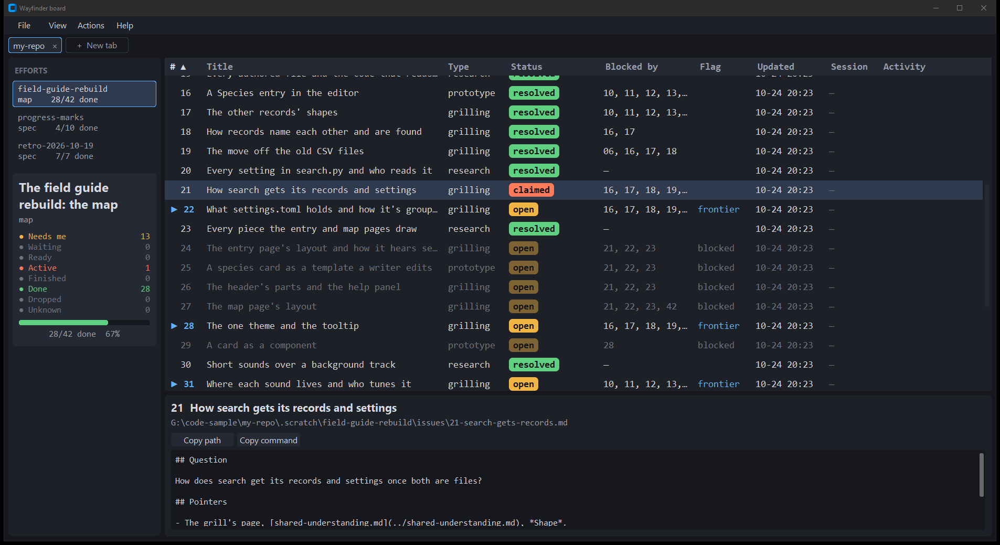
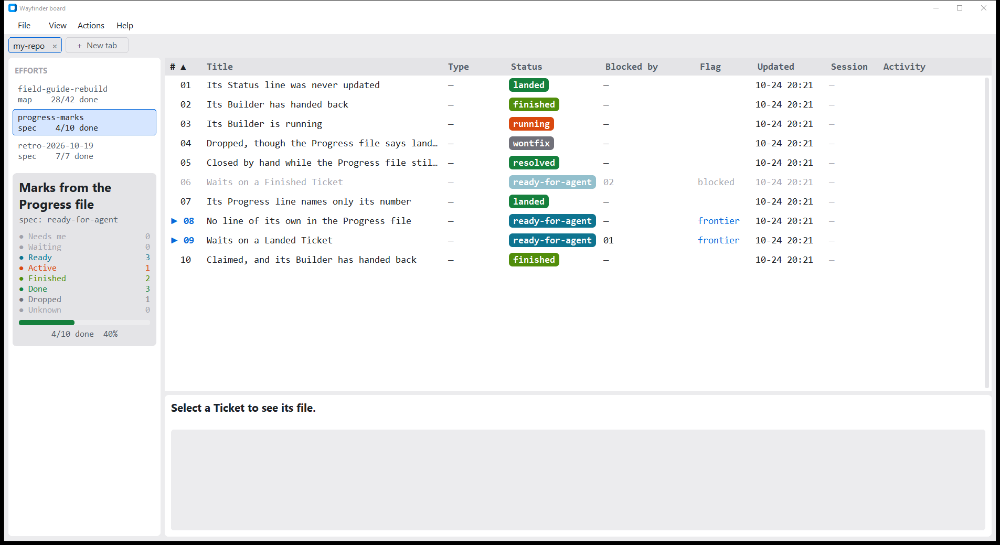

# Wayfinder board

A desktop viewer for the maps and trackers under a repo's `.scratch/` folder. It shows each
Effort as a Board of its Tickets and refreshes as the files change. It only reads them.



## Who it's for

The Board is for people who work in the Wayfinder flow from
[Matt Pocock's skills](https://github.com/mattpocock/skills) for Claude Code: `/wayfinder` maps,
`/to-spec` specs, `/to-tickets` Tickets and `/implement` Builders, all kept as markdown files
under `.scratch/<effort>/`. If your work isn't tracked in that layout, the Board has nothing to
show you yet.

It is unofficial. It is not affiliated with or endorsed by Matt Pocock.

## What it reads, and what it writes

It reads, and only reads:

- **Your Effort folders**: the markdown files under the folders you open as tabs.
- **Your Claude Code transcripts**: the session files under Claude Code's projects folder, to
  link Builders and Sessions to their Tickets. That folder is
  `$CLAUDE_CONFIG_DIR/projects` when that variable is set, else `~/.claude/projects`.
- **git**: it runs `git log` read-only in each tab's repo to find which Tickets are Landed on
  the repo's main branch.

It sends nothing anywhere: it makes no network connection. It writes only two files, both in
one folder: its Workspace file and its error log (see [The Workspace file](#the-workspace-file)
and [When something goes wrong](#when-something-goes-wrong)). The `--shot` flag also writes the
PNG you name.

## Install

You need Python 3.10 or later, with Tk. Check that Tk is there with `python3 -m tkinter`
(`py -m tkinter` on Windows): it opens a small window.

- **Windows and macOS (python.org installers):** Tk is included.
- **Homebrew Python on macOS:** Tk is a separate formula. Install the one matching your Python
  version, such as `brew install python-tk@3.12`.
- **Linux:** Tk is a separate package. On Debian and Ubuntu, `sudo apt install python3-tk`; on
  Fedora, `sudo dnf install python3-tkinter`; on Arch, `sudo pacman -S tk`.

Then install it with [pipx](https://pipx.pypa.io/), which gives the Board its own environment
and puts a `wayfinder-board` command on your path:

```bash
pipx install git+https://github.com/vand-er/ai-repo-session-tracker
```

### From source

To change the code, clone the repo and make an editable install in a venv, so your edits take
effect at once:

```bash
git clone https://github.com/vand-er/ai-repo-session-tracker wayfinder-board
cd wayfinder-board
python3 -m venv .venv
.venv/bin/python -m pip install -e .
```

On Windows, use `py -3.10 -m venv .venv` and `.venv\Scripts\python.exe` in place of
`.venv/bin/python`.

Windows is the only system checked by hand. CI runs the tests on Windows, macOS and Linux, but
nobody has clicked through the Board on macOS or Linux yet.

## Run

```bash
wayfinder-board
```

From source, `.venv/bin/wayfinder-board` or `python -m src` (from the repo root) does the same.
On Windows you can also double-click `Wayfinder Board.bat`, which starts it without a console
window.

It opens the tabs you had open last time. Use **File → New tab** to open a folder. A folder
that holds `.scratch/` opens as a repo root, with every Effort under `.scratch/` in a list.
Any other folder opens as one Effort. An Effort folder with only an `issues/` folder in it
(no `map.md` or `spec.md`) counts as a build Effort, so Copy command on its Tickets gives
`/implement`.

A Ticket's badge also reads its Effort's `progress.md`. A line `- NN-slug: running` shows
it Active, `finished` shows it Finished (its own colour, not yet on main, still blocking the
Tickets that wait on it), and `landed <sha>` shows it Done. The furthest along of that line
and the Ticket's `Status:` line wins, except that a Dropped Status line always wins.



A Ticket is also Landed, and Done, when a commit on the repo's main branch names it. Main is
the tab's branch setting if you set one (see below), else the branch `origin/HEAD` names, else
`main`, else `master`. A folder outside git simply shows nothing Landed.

On Windows, the title bar is light on a light palette and dark on a dark one. If Windows has
"Show accent colour on title bars" on, the title bar takes the accent colour instead.

Flags:

- `--workspace FILE` loads and saves another Workspace file instead of yours.
- `--open FOLDER` opens a tab on `FOLDER`, as File → New tab does.
- `--effort NAME` shows the Effort `NAME` in the fronted tab.
- `--select FILE` then clicks that Ticket's row, scrolling it into view.
- `--theme NAME` then switches to the palette `NAME` live, as View → Theme does.
- `--sessions` opens the Sessions tab, as View → Sessions does.
- `--menu NAME` then opens the menu `NAME` (File, View, Actions or Help), so `--shot`
  shows it open. Any other name is an error that lists the menus.
- `--shot PNG` (Windows only) draws the window, saves a PNG of it, and quits. The window opens
  on the monitor that does not hold your window, behind everything, and never takes the focus.
  If the PNG isn't saved within 20 seconds (`SHOT_LIMIT_S` in `src/__main__.py`), it exits
  with code 3 and says so, instead of hanging.

For example:

```bash
wayfinder-board --workspace /tmp/ws.json --open ~/code/my-repo --effort my-effort --shot /tmp/board.png
```

## The Workspace file

The app keeps its state in `~/.wayfinder-board/workspace.json` (on Windows,
`%USERPROFILE%\.wayfinder-board\workspace.json`). The `--workspace` flag or the
`WAYFINDER_BOARD_WORKSPACE` variable picks another file. A missing or broken file never stops
the app: each bad key falls back to its default.

The app writes these keys itself:

- `tabs`: the folder of each open tab.
- `active`: the index of the fronted tab.
- `palette`: the chosen palette's name. Pick one in View → Theme.
- `show_detail_pane`: View → Show detail pane. Default `true`.
- `show_area_column`: View → Show Area column. Default `false`.

You can add these by hand:

- `poll_interval_ms`: how often the fronted tab is checked for changes. Default `1000`, least `100`.
- `show_scan_counter`: show each tab's scan count in the window title. Default `false`.
- `sessions_window_minutes`: how far back the Sessions tab looks. Default `30`.
- `claude_projects_dir`: where Claude Code keeps its sessions. Default `$CLAUDE_CONFIG_DIR/projects` when that variable is set, else `~/.claude/projects`.
- `owner_window_note`: for `--shot` and the timing tool only, a JSON file holding your own
  window's `x`, `y`, `width` and `height`, kept by some other tool. Scripted windows then open
  on the other monitor from that window. Unset by default.

The app keeps any other key as it found it.

### The branch setting

If the Board reads Landed from the wrong branch, name the right one for that tab. It has no
menu item: edit the tab's entry in `tabs`, turning the folder string into an object with a
`branch`. Folders are full paths, as the app saved them:

```json
{
  "tabs": [
    "/home/me/code/my-repo",
    {"folder": "/home/me/code/other-repo", "branch": "trunk"}
  ]
}
```

A tab without a branch stays a plain folder string. A branch setting naming a branch the repo
doesn't have shows nothing Landed, with the line `main not read: no branch found`.

## When something goes wrong

- **A tab whose scan fails** shows `Unreadable: <folder>` and the error's reason in place of
  its Board. It keeps polling, and shows the Board again once the cause is fixed.
- **A tab whose main branch can't be read** shows one line above the Board,
  `main not read: <reason>`: `git not found`, `git failed`, `timed out` or `no branch found`.
  The rest of the Board still shows; only Landed is missing.
- **Every unexpected error** is written to `error.log`, beside the Workspace file: by default
  `~/.wayfinder-board/error.log`. Each entry holds the time, the tab's folder and the
  traceback. The file keeps about the newest 64 KiB and drops older entries.

The error log stays on your machine. If you file an issue, you may paste from it, but read it
first: it holds the full paths of your folders, which may name you or your projects.

## Add a palette

A palette is one JSON file in `src/palettes/`. Its file name, without `.json`, is the name
in View → Theme. Copy `src/palettes/graphite.json` and change the values.

The file must have every slot, and no others:

- Colours, as `#rrggbb`: `bg`, `bg_panel`, `bg_raised`, `bg_select`, `line`, `text`,
  `text_dim`, `text_muted`, `accent`, `flash`, `badge_text`.
- `family`: a colour for each of `Needs me`, `Waiting`, `Ready`, `Active`, `Finished`,
  `Done`, `Dropped`, `Unknown`.
- Fonts: `font_mono`, `font_ui`. Each is one family name or a list of them, best first,
  such as `["Consolas", "Menlo", "DejaVu Sans Mono"]`. The first one installed is used;
  when none is, Tk's own default fixed or UI font is.
- `size`, in points: `table_dense`, `table_airy`, `detail`, `readout`, `ui`, `section`,
  `detail_title`, `header_title`, `card_title`.

Then run the tests. `tests/test_palettes.py` checks every file in `src/palettes/` has
exactly these slots and loads as itself. A file that is short of a slot makes the app use
the default palette, `graphite`.

## Contributing

Issues are open: bug reports, and ideas for what the Board should show. Pull requests are
closed for now; please open an issue instead.

The repo's own work is tracked the way the Board expects, as Efforts under `.scratch/`, so the
Board can show its own progress. `CLAUDE.md` and `docs/agents/` tell an agent how the repo
works; `GLOSSARY.md` and `docs/adr/` hold its words and its decisions.

### Tests

From the repo root, with the editable install:

```bash
python -m unittest discover
```

The tests never touch your own Workspace file. `tests/__init__.py` points them at a temp one.
Their fixtures are invented Efforts, and so are the screenshots above.

The suite also runs the personal-strings check, `tools/personal_strings.py`. It fails when
a tracked file holds a user-home path, a drive-letter project path or an email address
other than a noreply one. To check for your own names too (your handle, folders, other
projects), keep them in a file outside the repo, one regular expression per line, and pass
it, say from a pre-commit hook:

```bash
python tools/personal_strings.py --extra ~/.config/personal-strings.txt
```

### Timing

`tools/time_board.py` (Windows only) times the real window against a 20 ms bar: switching
Effort, re-clicking it, selecting a row, sorting, the two View toggles, switching theme,
switching tab (Board to Board, to and from Sessions), one wheel step of scrolling, a poll with
nothing changed and one with a row changed, and startup. It times the Source folder you give
it and a generated Effort of 400 Tickets, and prints the median of each in a table. The poll's
scan runs on a background thread, so a poll counts only its time on the UI thread; the scan's
own time is shown in rows with no bar:

```bash
python tools/time_board.py ~/code/my-repo --label after --out timing/after.md --shots timing
```

`--shots DIR` also saves a `--shot` PNG of every view. `--quick` takes 3 runs of each,
for a check while building. `--owner-note FILE` places its windows as the
`owner_window_note` setting does. It never touches your Workspace file, and only reads the
folder you give it. Its windows, like every `--shot` window, open on the monitor that does
not hold your window, behind everything, and never take the focus. It is not part of the
tests, so a slow machine never fails a test run.

## Licence

MIT. See [LICENSE](LICENSE).
